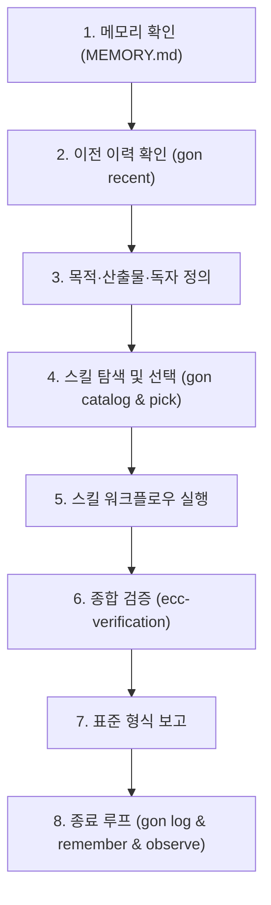

# Gon 워크플로 및 스킬 실행 가이드 (Codex & Antigravity)

> 이 문서는 Codex CLI 및 Google Antigravity(Gemini) 환경에서 **Gon 비서 에이전트 프로토콜**과 **45개 스킬 풀**을 능동적으로 활용하기 위한 공식 마스터 런북입니다.
> 원문 지침: [ai/gon/GON.md](file:///C:/Users/aicam/Desktop/수업_AX_W/수업/side_pj/ai/gon/GON.md) | 상세 절차: [ai/gon/WORKFLOWS.md](file:///C:/Users/aicam/Desktop/수업_AX_W/수업/side_pj/ai/gon/WORKFLOWS.md)

---

## 0. 공통 작업 실행 뼈대 (8단계 표준 프로토콜)

모든 작업 착수 시 Codex와 Antigravity는 아래 8단계를 반드시 순서대로 수행합니다:



1. **메모리 확인**: [ai/gon/memory/MEMORY.md](file:///C:/Users/aicam/Desktop/수업_AX_W/수업/side_pj/ai/gon/memory/MEMORY.md)를 열어 사용자 선호와 아키텍처 결정을 확인합니다.
2. **사전 이력 확인**: 파일 변경 작업이면 `python -I ai/gon/gon.py recent`를 실행합니다.
   - 이전 작업 이력을 파악하고, uncommitted 변경 파일은 `git diff <파일>`로 먼저 변경 의도를 파악합니다.
   - 다른 AI가 몇 분 내에 수정한 파일은 동시에 수정하지 않습니다.
3. **의도 정의**: 목적, 산출물, 독자를 확정합니다 (해석이 갈릴 때만 사용자에게 명확히 질문).
4. **스킬 선택**: `python -I ai/gon/gon.py catalog`로 확인 후 `python -I ai/gon/gon.py pick <id...> [--dev]`를 실행합니다.
   - `[핵심-항상]`(karpathy, ecc-verification 등) 발췌문은 예외 없이 준수합니다.
5. **스킬 워크플로우 수행**: 아래 핵심 요약 및 [references/skills-workflows.md](file:///C:/Users/aicam/Desktop/수업_AX_W/수업/side_pj/.agents/skills/gon-workflows/references/skills-workflows.md)의 단계별 절차를 순서대로 이행합니다.
6. **품질 검증**: `ecc-verification` 루프 수행 (빌드, 타입 검사, 백엔드 테스트, 보안 체크).
7. **표준 보고**: 첫 줄에 `🎯 [Active Skills]: a → b → c` 기재 후 결과 / 확인한 것 / 남은 위험을 보고합니다.
8. **종료 루프**:
   - 파일 변경 시: `python -I ai/gon/gon.py log --by <gemini|codex> "<한 일 / 결과 / 확인·미확인 / 인수인계>"`
   - 지속 기억할 사실: `python -I ai/gon/gon.py remember "<한 줄>"`
   - 스킬 결함 발견: `python -I ai/gon/gon.py observe --by <gemini|codex> <스킬id> "<개선점>"`

---

## 1. Claude 전용 도구의 Codex & Antigravity 완벽 대체 규칙

상세 지침: [references/claude-replacement.md](file:///C:/Users/aicam/Desktop/수업_AX_W/수업/side_pj/.agents/skills/gon-workflows/references/claude-replacement.md)

| Claude Code 도구 | Antigravity (Gemini) 대체 실행 | Codex CLI 대체 실행 |
|---|---|---|
| `AskUserQuestion` | `ask_question` 도구 또는 1, 2, 3 번호 목록 질문 | 번호 목록으로 선택지 제시 (1번에 추천안) |
| 서브에이전트 병렬 실행 (`Agent(...)`) | `invoke_subagent` (research / self) 또는 순차 도구 호출 | 순차 도구 실행 또는 `codex exec` 비대화 실행 |
| `${CLAUDE_SKILL_DIR}` | 해당 스킬 지침 파일이 위치한 폴더 절대/상대 경로 | 해당 스킬 폴더 기준 상대 경로 |
| 브라우저 도구 (`claude-in-chrome`) | `agent-browser` CLI (`agent-browser open/screenshot`) | `agent-browser` CLI 또는 Playwright 도구 |
| `$ARGUMENTS` 매개변수 | 사용자가 프롬프트에서 전달한 인수값 | 프롬프트 인자값 |
| 슬래시 커맨드 (`/<명령>`) | `python -I ai/gon/gon.py <명령>` 파이썬 CLI 직접 실행 | `python -I ai/gon/gon.py <명령>` 파이썬 CLI 직접 실행 |

---

## 2. Gon CLI 핵심 명령어 퀵 레퍼런스

상세 지침: [references/cli-commands.md](file:///C:/Users/aicam/Desktop/수업_AX_W/수업/side_pj/.agents/skills/gon-workflows/references/cli-commands.md)

```powershell
# 1. 작업 시작 전 이력 및 uncommitted 변경 확인
python -I ai/gon/gon.py recent

# 2. 전체 스킬 카탈로그 확인
python -I ai/gon/gon.py catalog

# 3. 스킬 선택 및 지침 경로 확보 (--dev는 개발/UI 코어 자동 포함)
python -I ai/gon/gon.py pick --dev taste ui-ux-pro-max

# 4. 작업 종료 후 이력 로깅 (필수)
python -I ai/gon/gon.py log --by gemini "상세 작업 내용 / 결과 / 테스트 완료 / 특이사항"

# 5. 영구 선호/규칙 기록
python -I ai/gon/gon.py remember "사용자 선호: 버튼 반응 시간 200ms 고정"

# 6. 스킬 이슈 기록 및 점검
python -I ai/gon/gon.py observe --by gemini taste "그라디언트 예외 규칙 추가 필요"
python -I ai/gon/gon.py review

# 7. 전체 시스템 상태 진단
python -I ai/gon/gon.py doctor
```

---

## 3. 핵심 스킬별 실행 워크플로우 요약

상세 지침: [references/skills-workflows.md](file:///C:/Users/aicam/Desktop/수업_AX_W/수업/side_pj/.agents/skills/gon-workflows/references/skills-workflows.md)

### 3.1 [핵심-항상] (모든 코드 작업에 자동 적용)
- **`karpathy`**: 단순함 우선. 요청 범위만 변경. 불필요한 추상화 금지, 작업 전 가정 명시, 필요한 줄만 최소 수정.
- **`ecc-verification`**: 완료 전 검증 루프.
  1. Frontend 빌드: `cd user/frontend && npm run build`
  2. Frontend 타입: `cd user/frontend && npx tsc --noEmit`
  3. Backend 테스트: `cd user/backend && python -m pytest -q`
  4. 보안 점검: 비밀값(`sk-`, 비밀번호) 및 불필요한 `console.log` 잔여 여부 확인
  5. 변경 범위: `git diff --stat`으로 의도한 파일만 변경되었는지 확인
- **`ecc-coding-standards`**: 가독성 → KISS → DRY → YAGNI 순서 준수. 명확한 네이밍, 불변 갱신, 에러 삼킴 금지.

### 3.2 [개발 코어] (`gon pick --dev`)
- **`ponytail`**: 코드 감사·리뷰·기술부채 점검. "가장 단순한 해결책" 탐색. 필요 없으면 안 만든다 → 기존 코드 재사용 → 표준 라이브러리 → 기존 의존성 → 최소 코드.
- **`context7`**: 최신 라이브러리 공식 문서 조회 (`npx ctx7@latest library <이름>` -> `docs <ID>`).
- **`graphify`**: 코드베이스 AST 및 파일 관계를 지식 그래프로 매핑하여 구조 파악.
- **`headroom`**: 긴 로그/도구 출력 필터링 및 토큰 절약.
- **`ecc`**: 1,000+ 하위 스킬 모음. 필요한 경우 `grep -ril "<주제>" ai/gon/skills/repos/ECC/skills`로 찾아 개별 `SKILL.md`만 참조.

### 3.3 [코드·UI 작업]
- **`taste` (`design-taste-frontend`)**: 랜딩/앱 화면 안티슬롭 디자인.
  - 실행: `node .agents/skills/design-taste-frontend/scripts/draw.mjs ...`
  - 하우스 규칙: 서체 2종 이내, 2줄 이내 제목, 좌우 대칭 여백, 이모지·그라디언트 절제.
- **`ui-ux-pro-max`**: 컴포넌트·디자인시스템·상태(로딩/빈값/에러)·반응형 완성도 점검.
- **`impeccable`**: UI 마감(polish), 결함 탐지 및 휴리스틱 비평.
- **`ecc-react`**: 순수 함수 렌더링, 상태 끌어올림, 접근성 마크업, React 18 호환 준수.
- **`ecc-fastapi`**: 얇은 라우터, 서비스 계층 분리, Pydantic v2 검증, async 비차단.
- **`ecc-a11y`**: 웹 접근성 (시맨틱 태그, ARIA 보충, 키보드 조작, 4.5:1 명도 대비).
- **`ecc-code-review`**: 코드 변경 후 품질/보안/유지보수성 리뷰.

### 3.4 [디자인·모션·비주얼]
- **`motion`**: 모션 설계 및 감사. 생산성 UI는 200~300ms ease-out 원칙 준수.
- **`emilkowalski`**: 마이크로 인터랙션 디테일. 진입 ease-out, `scale(0.95)` 시작, transform/opacity 위주.
- **`shadergradient`**: React 3D 백그라운드 쉐이더 그라디언트 (`user/frontend/src/components/Backdrop.tsx`).
- **`react-three-fiber`**: 3D 인터랙티브 씬 (`user/frontend/src/components/office3d/`).

### 3.5 [리서치·브라우저·데이터]
- **`agent-browser`**: 실제 브라우저 자동화 (클릭, 타이핑, 스크린샷, E2E 웹앱 테스트).
- **`scrapling` / `firecrawl`**: 지능형 웹 스크래핑 및 마크다운 크롤링.
- **`k-skill`**: 한국 공공데이터, 법령, 판례, DART 공시, HWP 문서 처리 (`ai/gon/skills/repos/k-skill`).
- **`agency-agents`**: 약 325개 전문가 페르소나(마케팅, 전략, 카피라이팅 등) 역할 채택.
- **`im-not-ai`**: AI가 생성한 한글 텍스트를 사실/수치 왜곡 없이 자연스럽게 윤문.

### 3.6 [검증·보안]
- **`court`**: 중요한 기술/아키텍처 결정 시 반론 배심원단 시뮬레이션을 통한 동조 편향 방지.
- **`strix`**: OWASP Top 10 기반 보안 취약점 점검 및 검증.
- **`rea`**: 합법적 리버스 엔지니어링 및 바이너리/Electron 앱 분석.

---

## 4. 세부 런북 참조 링크

1. [Gon CLI 명령어 상세 워크플로우 가이드](file:///C:/Users/aicam/Desktop/수업_AX_W/수업/side_pj/.agents/skills/gon-workflows/references/cli-commands.md)
2. [Claude 전용 도구의 Codex & Antigravity 대체 가이드](file:///C:/Users/aicam/Desktop/수업_AX_W/수업/side_pj/.agents/skills/gon-workflows/references/claude-replacement.md)
3. [45개 스킬별 세부 실행 워크플로우 명세서](file:///C:/Users/aicam/Desktop/수업_AX_W/수업/side_pj/.agents/skills/gon-workflows/references/skills-workflows.md)
