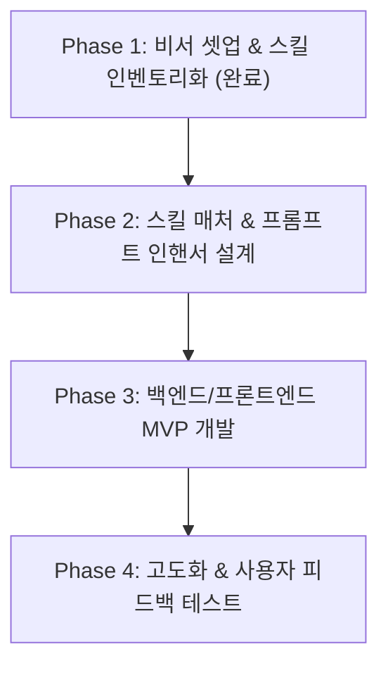

# 🗺️ 전국민 AI 평준화 서비스 개발 로드맵 (Roadmap)

> 비서 Agent Gon이 관리하는 단계별 기획 및 개발 마스터플랜입니다.

---

## 📌 비전 (Vision)
> **"누구나 1줄의 질문만으로 상위 1% 프롬프트 전문가와 디자이너의 결과물을 얻는 세상"**

---

## 🚀 마일스톤 및 단계별 태스크

### [Phase 1] 비서 체계 수립 및 리소스 체계화 (진행 완료 ✅)
- [x] 전용 비서 Agent Gon 프로필 및 행동 원칙 수립 (`Gon/AGENT.md`)
- [x] 수집된 31개 글로벌 AI 스킬/도구 분석 및 인벤토리화 (`Gon/skills/inventory.md`)
- [x] 작업 디렉토리 체계 구축 (`Gon/skills/`, `Gon/tasks/`, `Gon/workspace/`)

---

### [Phase 2] 스킬 라우터 & 프롬프트 인핸서 코어 설계 (현재 단계 🎯)
일반 사용자의 부족한 입력을 보완하고 적합한 스킬을 연결해주는 핵심 로직 설계.
- [ ] **Task 2-1. Skill Registry 표준 JSON/YAML 스키마 정의**
  - 각 스킬의 메타데이터(이름, 트리거 키워드, 카테고리, 요구 입력, 지침, 템플릿) 데이터화.
- [ ] **Task 2-2. 의도 분석기 (Intent Clarifier) 프로토타입 작성**
  - 모호한 사용자 질문을 분석하여 1~2개의 핵심 질문을 역제안하거나 자동 보정하는 프롬프트 작성.
- [ ] **Task 2-3. 스킬 매칭 알고리즘 (Skill Matcher)**
  - 사용자 요구사항 임베딩 vs 스킬 설명 간의 시맨틱 유사도 매칭 또는 경량 LLM 기반 라우터 구현.

---

### [Phase 3] 풀스택 MVP 서비스 구현 (개발 단계)
현재 프로젝트의 `backend/`와 `frontend/`를 활용한 실제 서비스 빌드.
- [ ] **Task 3-1. Backend Core API (FastAPI / Python)**
  - 스킬 카탈로그 조회 API (`/api/skills`)
  - 의도 분석 및 스킬 추천 API (`/api/route`)
  - 스킬 주입 기반 작업 실행 스트리밍 API (`/api/generate`)
- [ ] **Task 3-2. Frontend UI/UX (React + Tailwind + Taste/Visuals)**
  - `taste-skill` 및 `shadergradient`가 적용된 감각적인 미니멀리즘 인터페이스.
  - "스킬 적용 상태"를 보여주는 비주얼 인디케이터 (투명한 AI 프로세스).
  - 결과물 렌더링 및 "프롬프트 성장 팁(평준화 교육)" 영역 구현.

---

### [Phase 4] 실전 검증 및 고도화
- [ ] **Task 4-1. 대표 도메인 3선 집중 튜닝**
  1. 기획/사업계획서 작성 (K-Skill + 논리 검증)
  2. 고감도 웹/랜딩페이지 기획 (Taste + UI/UX Pro Max)
  3. 실시간 트렌드 분석 및 리서치 (Firecrawl/Scrapling + 요약)
- [ ] **Task 4-2. 사용자 평가 및 프롬프트 개선율 측정**

