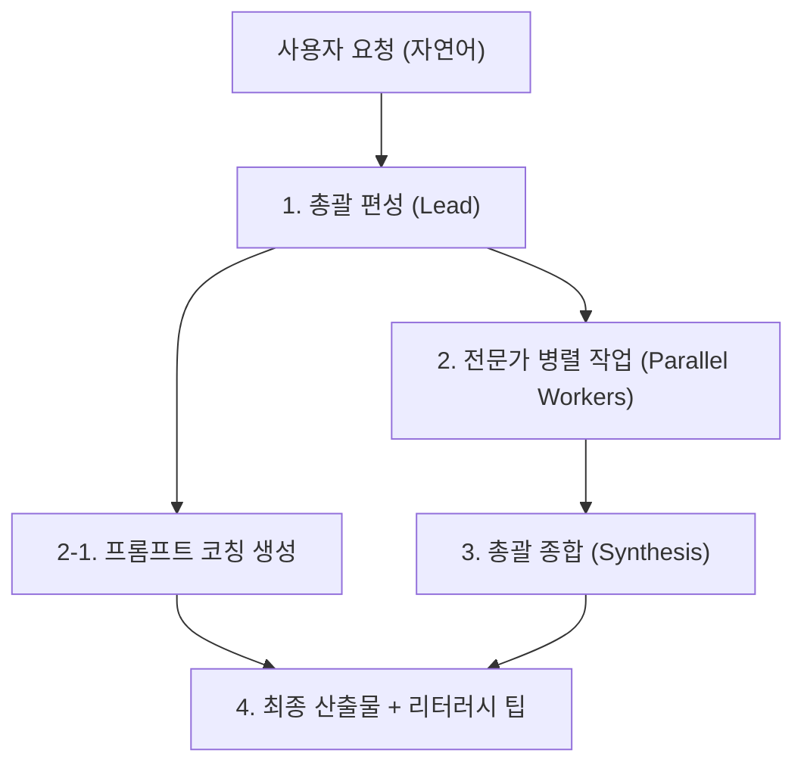

# Gon: 전국민 AI 평준화 플랫폼

사용자가 한 줄의 자연어 요청을 입력하면 최적의 AI 전문가 팀을 편성해 작업을 수행하고, 단일 산출물로 종합한 뒤 다음 질의를 위한 프롬프트 코칭까지 제공하는 멀티 에이전트 서비스다.

저장소 전체가 Gon이며, 비서 에이전트(`Gon/`)와 웹 서비스(`backend/`, `frontend/`)가 같은 스킬·프롬프트 풀을 공유해 동작한다.

---

## 1. 요청 처리 흐름



1. **편성 (Planning)**
   - 담당: `backend/app/core/pipeline.py` (`_plan_prompt`, `_keyword_plan`), `backend/app/core/experts.py`
   - 총괄(Gon)이 전체 전문가 풀(스킬 45개 + 프롬프트 3개)의 직함과 설명을 검토해 필요한 인원(최대 `GON_MAX_EXPERTS`명)과 과업(task)을 배정한다.
   - 하위 스킬이 수백 개인 전문가(`anthropic-skills`, `k-skill`, `agency-agents`, `scientific`, `ecc`)를 고를 때는 총괄이 요청을 분석해 하위 스킬 파일을 찾을 영문 검색어(`terms`)도 함께 낸다. 키워드 사전은 두지 않으며, 검색어와 맞는 파일이 없으면 기본 지침만 쓴다(`experts._find_sub_skill`).
   - 사용자가 화면(`RosterDrawer`)에서 전문가를 직접 지정한 경우 최우선으로 편성한다.
   - AI 미연결 또는 응답 실패 시 키워드 매칭과 시너지 관계 기반 대체 로직(`_keyword_plan`)으로 자동 전환된다.
2. **전문가 병렬 작업 (Parallel Execution)**
   - 담당: `backend/app/core/pipeline.py`, `backend/app/core/llm.py`
   - 배정된 각 전문가는 스킬 지침(YAML 헤더 제거, 3000자 발췌)과 공통 규칙(`Core 1~4`)을 근거로 독립적인 텍스트 결과물을 작성한다.
   - `ThreadPoolExecutor`를 통해 지정된 워커 수(`GON_LLM_WORKERS`)만큼 병렬로 비동기 실행된다.
   - 이 과정에서 사용자의 후속 질의 역량을 돕기 위한 프롬프트 개선 팁(`_coach_prompt`)도 함께 생성된다.
   - 전문가 작업이 완료되거나 에러가 발생하면 실시간 NDJSON 스트림(`type: agent`)으로 화면에 즉시 전달된다.
3. **종합 (Synthesis)**
   - 담당: `backend/app/core/pipeline.py` (`_synthesis_prompt`)
   - 총괄 편집자가 각 전문가의 결과물을 수합하여 모순점을 정리하고 하나의 완성된 산출물로 통합한다.
   - 미확인 사실 날조 금지, 출처와 가정 명시 등 `Core 1~4` 원칙을 적용해 최종 결과(`type: final`)를 반환한다.

---

## 2. API 엔드포인트

| 메서드 | 경로 | 설명 | 요청 본문 | 응답 형태 |
|---|---|---|---|---|
| `GET` | `/health` | 서버 상태 점검 | 없음 | `{"service": "Gon API", "status": "online", "version": "1.0.0", "mission": "..."}` |
| `GET` | `/api/office/pool` | 전문가 풀 현황 및 통계 | 없음 | `{"total": 48, "clusters": {...}, "mode": "ai"\|"stub", "max_experts": 8}` |
| `GET` | `/api/office/experts` | 48명 전체 전문가 카탈로그 | 없음 | `{"experts": [{"id": "...", "name": "...", "kind": "...", "cluster": "...", "accent": "...", "use_for": "..."}]}` |
| `POST` | `/api/office/dispatch-stream` | 멀티 에이전트 실행 및 NDJSON 스트리밍 | `{"query": "요청문", "selected_expert_ids": ["id1", "id2"]}` (선택 배열 생략 가능) | `application/x-ndjson` (이벤트 순서: `start` → `plan` → `agent`... → `synthesis` → `final`) |

> 키워드 기반 옛 라우터(`orchestrator.py`)와 `/api/skills`, `/api/route`, `/api/generate`, 호환용 임시 응답(`/api/office/layout`, `/v1/models`)은 제거했다. 선택은 AI가 요구사항을 분석해서 하며, 외부 API 키는 쓰지 않는다.

---

## 3. 환경변수

| 변수명 | 기본값 | 설명 |
|---|---|---|
| `GON_LLM` | `auto` | `auto`는 Antigravity `agy`만 쓴다. `stub`이면 AI 호출 없이 모의 응답. 다른 구독을 조용히 쓰지 않도록 `gemini`·`claude`·`codex`는 직접 지정했을 때만 쓰고, 프롬프트는 stdin으로 넘긴다 |
| `GON_LLM_WORKERS` | `4` | 전문가 병렬 작업 동시 호출 스레드 수 |
| `GON_MAX_EXPERTS` | `16` | 깊이(빠르게 4·보통 8·깊게 16)와 무관하게 한 요청에 배정할 수 있는 절대 상한 |
| `AGY_PATH` | (자동 감지) | Antigravity CLI(`agy` 또는 `agy.exe`) 실행 파일 절대 경로 직접 지정 |

---

## 4. 실행 및 테스트 방법

### 서비스 구동
```powershell
# 전체 통합 실행 (백엔드 8000 + 프런트엔드 5173 동시 구동)
python Gon/gon.py run

# 서비스 상태 확인
python Gon/gon.py doctor

# 서비스 종료
python Gon/gon.py stop
```

개별 수동 구동:
- **백엔드:** `cd backend && python -m uvicorn app.main:app --host 127.0.0.1 --port 8000`
- **프런트엔드:** `cd frontend && npm run dev`

### 백엔드 테스트 실행
테스트 환경은 `GON_LLM=stub`로 강제되어 실제 AI 호출을 소모하지 않는다.
```powershell
cd backend
python -m pytest -q
```

---

## 5. 확인 필요

1. **전문가 풀 동적 확장:** 현재 `registry/skills.json`(45개)과 `prompt/*.md`(3개)의 48명 구조에서 외부 스킬(`status: external`) 추가 시 자동 반영 정책.
