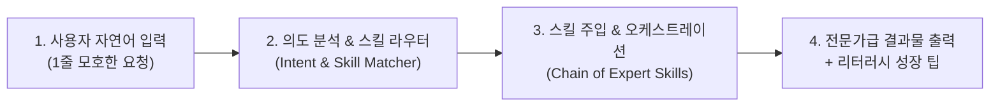

# 🌐 전국민 AI 평준화 플랫폼 (Project: SkillBridge)

> **"누구나 1줄의 질문만으로 상위 1% 프롬프트 전문가와 디자이너의 결과물을 얻는 세상"**  
> AI 활용 역량 격차(Prompt/Skill Gap)를 해소하는 지능형 스킬 라우팅 & 리터러시 서비스

---

## 1. 추진 배경 및 필요성 (Background)
* **문제점 (Prompt Gap):** AI 모델의 성능은 상향 평준화되었으나, 프롬프트 엔지니어링 역량과 워크플로우 구성 능력에 따라 일반 사용자와 전문가 간의 결과물 품질 차이가 극심하게 벌어지고 있음.
* **사용자 고통 (User Pain Point):** 일반 대중은 무엇을 어떻게 질문해야 할지 모르며, AI가 주는 모호한 답변에 실망하고 이탈하는 현상 발생.
* **해결책 (Solution):** 사용자의 불완전한 자연어 요청을 분석하여, 사전에 검증된 최적의 **AI Skill 클러스터를 자동으로 찾아 장착(Mount)**하고 실행해주는 지능형 중개 플랫폼.

---

## 2. 서비스 핵심 기능 (Key Features)



1. **지능형 의도 분석기 (Intent Clarifier):**
   - 모호한 입력을 분석하여 핵심 목적, 타깃, 톤앤매너 등 누락된 맥락을 스스로 보정하거나 가벼운 선택형 역질문 제공.
2. **동적 멀티-스킬 라우팅 (Skill Orchestrator):**
   - 수집된 지식 네트워크(기획, 마케팅, UI/UX, 코딩, 리서치 등)에서 최적의 스킬 3~5개를 자동 결합.
3. **투명한 스킬 프로세스 시각화 (Thinking UI):**
   - 어떤 스킬이 적용되어 작업 중인지 실시간 오브(Thinking Orb) 및 상태 인디케이터로 시각화.
4. **AI 리터러시 사후 교육 (Prompt Coach):**
   - 결과물 하단에 *"다음번에는 이렇게 질문해보세요!"* 팁을 제공하여 사용자의 프롬프트 역량을 자연스럽게 상향 평준화.

---

## 3. 시스템 아키텍처 및 기술 스택 (Tech Stack)

### Backend (`backend/`)
- **Framework:** FastAPI (Python 3.10+)
- **Core Engine:** Gon Orchestration Engine (`Gon/workspace/orchestrator.py`)
- **LLM Provider:** Google Gemini API / OpenAI / Free LLM API
- **Key Modules:**
  - `/api/skills` : 스킬 레지스트리 카탈로그 조회
  - `/api/route` : 사용자 의도 분석 및 최적 스킬 추천
  - `/api/generate` : 스킬 주입 기반 스트리밍 결과 생성

### Frontend (`frontend/`)
- **Framework:** React (Vite) + TypeScript
- **Styling:** Tailwind CSS + Lucide Icons
- **Visual & UI Taste:** `thinking-orbs`, `OriginKit`, `shadergradient`
- **UX Goal:** 복잡한 설정을 배제하고, 검색창 중심의 극단적 미니멀리즘 인터페이스

---

## 4. 디렉토리 구조 (Directory Structure)
```
side_pj/
├── backend/                # FastAPI 백엔드 서버
│   ├── app/
│   │   ├── api/            # REST API 엔드포인트
│   │   ├── core/           # 스킬 라우터 & LLM 오케스트레이터
│   │   └── main.py         # 서버 진입점
│   ├── requirements.txt
│   └── .env.example
├── frontend/               # React + Tailwind 프론트엔드
│   ├── src/
│   │   ├── components/     # Thinking Orb, 스킬 뱃지, 결과 뷰어
│   │   ├── pages/          # 메인 프롬프트 입력 및 대시보드
│   │   └── App.tsx
│   └── package.json
├── docs/                   # 프로젝트 기획 및 설계 문서
│   └── README.md           # 본 명세서
└── Gon/                    # 총괄 비서 Gon의 작업 공간
```

