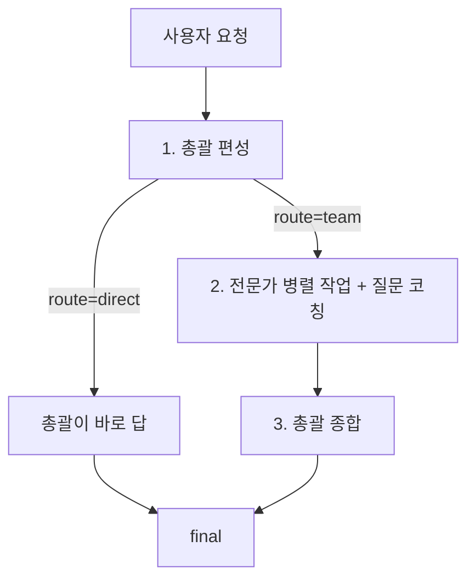

# 서비스 구조

Claude·Gemini·Codex와 사람이 함께 보는 서비스 설명서다. 사람용 소개와 설치는 루트 [README.md](../../README.md), AI 공통 규칙은 [AGENTS.md](../../AGENTS.md)에 있다.

## 명령

모두 저장소 루트에서 실행한다. 필요한 것: Git, Python 3.10+, Node 18+.

```
python -I ai/gon/gon.py run [--no-open]   # 의존성 설치 + 백엔드 :8000 + 프론트 :5173 (stop: gon stop, 상태: gon doctor)
cd user/backend && python -m app.main       # 백엔드만 reload로 실행 (:8000, 프론트 없이 API 디버깅)
cd user/frontend && npm run dev             # 프론트만 실행 (:5173, /api는 8000으로 프록시)
python -I ai/gon/gon.py <catalog|pick|recent|log|remember|observe|review|learn|fetch|install|always>

cd user/backend && python -m pytest -q                            # 전체 (test_gon_cli.py는 gon.py CLI를 검증)
cd user/backend && python -m pytest -q tests/test_pipeline.py -k plan   # 단일 파일/케이스
cd user/frontend && npx tsc --noEmit                              # 프론트 타입 검사 (린터 없음)
cd user/frontend && npm run build                                 # tsc && vite build
```

- 테스트는 `user/backend/`에서 돌린다. `conftest.py`가 `GON_LLM=stub`을 강제하고 `agy` 실행을 막으므로 실제 AI 호출은 일어나지 않는다.
- 서비스 코드를 고친 뒤에는 프론트 `tsc`, 백엔드 `pytest`를 돌리고 실제로 띄워서 본다(UI는 브라우저). 이미 서버가 떠 있으면 `gon run`은 포트 충돌로 거절하니 먼저 `gon stop`.
- `user/.env`나 `user/frontend/tailwind.config.js`를 고치면 서버를 다시 띄워야 반영된다.

## 설정 (`user/.env`)

설정 파일은 `user/.env` 하나다(예시: `user/.env.example`). 백엔드는 `core/config.py`가 경로를 지정해 읽고, 프론트는 `vite.config.ts`의 `envDir: '..'`로 같은 파일을 읽되 `VITE_`로 시작하는 값만 화면 코드에 넘긴다.

| 변수 | 기본값 | 설명 |
|---|---|---|
| `DATABASE_URL` 또는 `SUPABASE_DB_PASSWORD` | 없음 | Supabase PostgreSQL 연결. 비밀번호가 `[YOUR-PASSWORD]` 그대로면 SQLite로 폴백 |
| `JWT_SECRET` | 코드의 개발용 문자열 | 로그인 토큰 서명 키. 공개·배포 전 반드시 바꾼다 |
| `GOOGLE_CLIENT_ID`, `VITE_GOOGLE_CLIENT_ID` | 없음 | Google 로그인. 두 값은 같아야 한다 |
| `PORT`, `HOST`, `CORS_ORIGINS` | 8000, 0.0.0.0, localhost:5173·3000 | 백엔드 서버 |
| `GON_LLM` | `auto` | `auto`는 `gon install`에서 고른 메인 AI, 기록이 없으면 `agy`. `stub`이면 AI 없이 시험용 응답. `claude`·`gemini`·`codex`·`agy`로 직접 지정 가능 |
| `GON_LLM_WORKERS` | 4 | 전문가 동시 호출 수 |
| `GON_MAX_EXPERTS` | 16 | 깊이와 무관한 한 요청의 절대 상한 |
| `AGY_PATH` | 자동 감지 | Antigravity CLI 실행 파일 위치 |

## 요청 한 건의 흐름



흐름 전체는 `user/backend/app/core/pipeline.py`의 제너레이터 `run(query, selected_expert_ids, images, history, model, depth)` 하나에 있다. 이벤트(dict)를 `start → plan → agent* → synthesis → delta* → final`(실패 시 `error`) 순으로 내보내고, `api/routes.py`의 `POST /api/office/dispatch-stream`이 이를 NDJSON으로 흘려보낸다. 프론트 `App.tsx`가 이 스트림을 읽어 화면을 갱신한다. 이벤트 형태나 `DispatchRequest` 필드를 바꾸면 이 세 곳을 같이 본다.

1. **편성**: LLM이 전문가 풀 카탈로그에서 고르고(`_plan_prompt`/`_parse_plan`), 실패하거나 AI가 없으면 `_keyword_plan`(트리거 키워드 + synergy)으로 대체한다. 사용자가 직접 지정한 `selected_expert_ids`가 있으면 최우선. 편성 결과의 `route`가 `direct`이면 팀 없이 총괄이 바로 답하고(`_direct_prompt`, `agent` 이벤트 없음), `team`이면 2~3으로 간다.
2. **병렬 작업**: `ThreadPoolExecutor`(`GON_LLM_WORKERS`)로 전문가별 프롬프트 + 질문 코칭을 동시에 호출한다. 한 명이 실패해도 나머지는 계속한다.
3. **종합**: 총괄 편집자 프롬프트로 합치고, 실패하면 전문가 결과를 이어 붙인다. 종합과 바로 답은 `_answer`가 `delta`(글자 조각) 이벤트로 스트리밍한 뒤 `final`에 전체 글을 싣는다.

같은 대화의 이전 턴은 요청의 `history`로 오고 `_history_block`이 모든 프롬프트 앞에 붙인다(서버는 대화 상태를 갖지 않는다). 첨부 이미지는 편성·전문가·바로 답에만 가고 코칭·종합은 글만 본다.

## 핵심 연결 고리

- **전문가 풀 = 레지스트리**: `core/experts.py:load_pool()`이 `ai/gon/registry/skills.json`(status가 `external`이 아닌 것)과 `ai/gon/prompt/*.md` 일부를 읽어 전문가로 만든다(현재 48명). 화면 표시명은 `experts.NAMES`/`PROMPT_EXPERTS`에, 분야 라벨·색은 `CLUSTER_KO`/`CLUSTER_ACCENT`에 따로 있다. **스킬을 추가·삭제하면 레지스트리, `NAMES`, 풀 개수를 적은 문서(`README.md`, 이 문서), Codex·Gemini용 절차 문서 `ai/gon/WORKFLOWS.md`의 해당 절을 함께 맞춘다.**
- **지침 주입**: 전문가 프롬프트에는 해당 스킬 파일 3000자 발췌와 `ai/gon/prompt/outranks everything below.md`의 Core 1~4가 붙는다. 하위 스킬이 수백 개인 저장소(`MULTI_SKILL_IDS`)는 총괄이 낸 영문 `terms`로 `_find_sub_skill`이 세부 파일을 찾는다(한국어 키워드 사전은 두지 않는다).
- **스킬 저장소는 git 밖**: `ai/gon/skills/repos/`는 gitignore이고 `ai/gon/skills/repos.json`의 URL에서 처음 쓸 때 clone된다(`experts._ensure_repo` → `gon.py`). 새 PC에서는 `gon fetch all`. 우리가 만든 스킬만 `ai/gon/skills/local/`에 추적된다.
- **LLM 호출(`core/llm.py`)**: 외부 CLI를 서브프로세스로 부른다. 기본(`GON_LLM=auto`)은 메인 AI(`ai/gon/tools.local.json`의 `main`)를 쓴다. 화면에서 고른 모델은 `--model`로 넘긴다(claude 별칭, agy는 `agy models`). `agy`는 프롬프트를 인자로, 나머지는 stdin으로 넘긴다(.cmd 셸에서 줄바꿈이 잘리거나 명령이 실행되는 문제를 겪어서). 메인 AI가 사용량 한도에 걸리면(`is_quota_error`) 복귀 시각을 `ai/gon/.quota.local.json`에 저장하고 그동안 서브 AI로 넘어간다. CLI가 없으면 "(시험용)" 응답을 내고 화면에 그렇다고 표시한다.
- **팀 편성 규칙(`pipeline.py`)**: 사용자가 고른 깊이(`depth` fast/normal/deep → 상한 4/8/16, `DEPTHS`) 안에서 총괄이 요청 크기로 인원을 정하고, 전문가마다 관점(`lens`: dev=개발자 / service=서비스)을 붙인다. 종합은 분석 → 정리 → 시각화(```chart 막대 차트 JSON, 프론트 `Markdown.tsx`가 그림) → 개발(필요할 때 코드) 순서다.
- **인증·기록 저장(`core/database.py`, `core/auth.py`, `api/auth.py`, `api/history.py`, `models/`)**: SQLAlchemy 위에 있고 `main.py` 시작 시 `init_tables()`가 `create_all`을 돌린다. 마이그레이션 도구는 없고, 컬럼 추가는 `init_tables()` 안의 `ALTER TABLE`(실패 무시)로 한다. Supabase PostgreSQL에 붙고, 비밀번호가 비었거나 연결에 실패하면 `user/backend/gon_dev.db`(SQLite)로 조용히 폴백한다. 어느 쪽에 붙었는지는 `GET /api/auth/status`의 `mode`로 본다. 인증은 bcrypt + JWT(HS256, 7일). 대화 기록(`/api/history`)은 `get_optional_user`라서 비로그인도 `user_id IS NULL` 기록으로 쓰인다. **주의: `conftest.py`는 LLM만 막고 DB는 격리하지 않으므로, `test_auth.py`·`test_history.py`가 실제 앱 DB(`gon_dev.db` 또는 연결된 Supabase)에 `test_<ts>@example.com` 사용자를 만든다.** 돌리기 전에 어느 DB에 붙는지 확인한다.
- **프론트(`user/frontend/`)**: React 18 + Vite + Tailwind. `/api`는 vite proxy로 8000에 간다. 로그인(`auth.ts`, `LoginPage.tsx`)과 기록(`history.ts`)이 위 API를 부른다. 사무실 화면은 react-three-fiber 3D 직교 뷰(`components/office3d/`: `layout.ts`의 좌표·`MAX_ZOOM`이 총괄 책상 크기까지 묶음)이고, 총괄 패널(`GonPanel`)과 화면 좌표를 맞춰 전문가가 걸어가 전달하는 연출을 한다.

## API

| 메서드 | 경로 | 설명 |
|---|---|---|
| GET | `/health` | 서버 상태 |
| GET | `/api/office/pool` | 전문가 풀 통계, 연결된 AI(`llm`), 깊이 목록 |
| GET | `/api/office/experts` | 전문가 카탈로그 |
| POST | `/api/office/dispatch-stream` | 요청 실행, NDJSON 스트림 |
| GET | `/api/auth/status` | DB 연결 방식, Google 로그인 설정 여부 |
| POST | `/api/auth/signup`, `/login`, `/google`, `/logout` | 가입·로그인·로그아웃 |
| GET | `/api/auth/me` | 로그인한 사용자 (토큰 필수) |
| GET·POST·DELETE | `/api/history`, `DELETE /api/history/{id}` | 대화 기록 조회·저장·삭제 |

## UI 작업 전에

화면 구조는 피그마 Desktop-1(1440x1024) 기준이고, 사용자가 여러 번 바로잡은 결정(총괄 자리는 대화·사무실과 분리된 별도 카드, 프로젝트와 무관한 장식 기능 금지 등)이 `ai/gon/memory/MEMORY.md`에 있다. `user/frontend/`를 건드리기 전에 읽는다. 개발 스펙은 FastAPI, React+TypeScript, Supabase다(Supabase는 SQLAlchemy 경유 PostgreSQL 연결로만 쓰고 supabase SDK는 없다).
